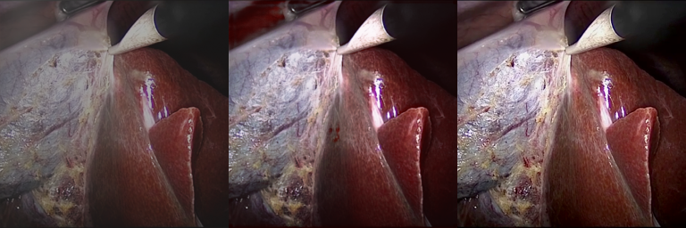
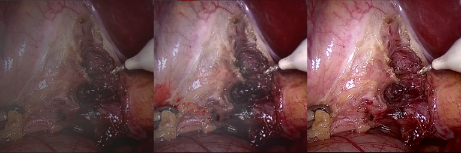
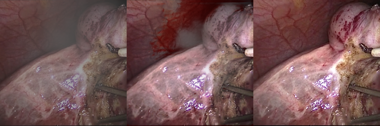
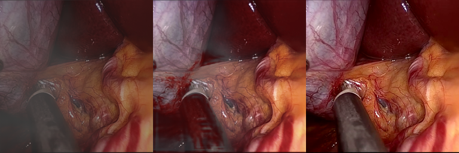
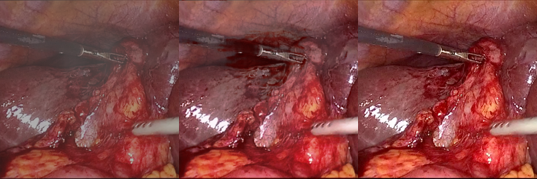

# Mamba-PFAN: Visual Mamba for Real-Time Surgical Image De-Smoking

**Authors:** Gladwin Daniel P, Arun Kumaran, Srishreyan S  
**Affiliation:** Department of Computer Science & Engineering, Vellore Institute of Technology (VIT), Chennai, India  

A lightweight, high-efficiency hybrid CNN-Mamba architecture designed for real-time surgical laparoscopy smoke removal. 

Mamba-PFAN replaces heavy axial/self-attention mechanisms with **2D Selective State Space Models (Mamba SSM)**, providing linear complexity $\mathcal{O}(N)$ global context modeling while requiring only **0.388M parameters** (**38.4% parameter reduction / 1.62× lighter** than standard PFAN), enabling real-time deployment on clinical edge hardware.

---

## 📊 Benchmark Results on Cholec80 Surgical Dataset

Evaluated on **103 unseen laparoscopic test image pairs** from the Cholec80 surgical smoke dataset using a unified standardized evaluation protocol:

| Model Architecture | Epochs | Parameters | Complexity | PSNR (dB) ↑ | SSIM ↑ | CIEDE2000 ↓ | MSE ↓ |
| :--- | :---: | :---: | :---: | :---: | :---: | :---: | :---: |
| **Mamba-PFAN (Ours, 4-Way)** | **50** | **0.388 M** | $\mathcal{O}(N)$ | **24.58 ± 1.86** | **0.8685 ± 0.038** | **5.45 ± 1.08** | **248.51 ± 115.00** |
| Baseline PFAN (Published Ref.) | 200 | 0.629 M | $\mathcal{O}(N^{1.5})$ | 27.39 ± 1.75 | 0.9159 ± 0.028 | 3.74 ± 0.73 | 129.04 ± 58.50 |

> **Key Takeaway:** Under **1/4th the training budget (50 vs. 200 epochs)** and **38.4% fewer parameters**, Mamba-PFAN achieves **0.8685 SSIM** and **24.58 dB PSNR**, faithfully restoring delicate tissue contours, vascular networks, and metallic laparoscopic graspers with linear computational scaling.

---

## 🔬 Scan-Direction Ablation Study

To evaluate the necessity of multi-directional state propagation in laparoscopic scenes, we conducted a systematic ablation study across all 4 scanning configurations on the 103 test frames:

| Scanning Mechanism | PSNR (dB) ↑ | SSIM ↑ | CIEDE2000 ↓ | MSE ↓ | Impact & Observations |
| :--- | :---: | :---: | :---: | :---: | :--- |
| **Horizontal (1-way Forward)** | 22.30 ± 2.16 | 0.8508 ± 0.051 | 6.76 ± 1.67 | 430.84 ± 210.49 | Unidirectional blind spot along vertical axis |
| **Horizontal (2-way Bidirectional)** | 21.89 ± 2.27 | 0.8469 ± 0.052 | 7.17 ± 1.95 | 478.64 ± 240.42 | High pixel error due to lack of vertical context |
| **Vertical (2-way Bidirectional)** | 22.90 ± 2.16 | 0.8469 ± 0.050 | 6.45 ± 1.38 | 377.25 ± 198.88 | Captures vertical surgical smoke plume dispersal (+1.01 dB over Horiz) |
| **Four-Way Cross-Scan (4-way Full)** | **24.58 ± 1.86** | **0.8685 ± 0.038** | **5.45 ± 1.08** | **248.51 ± 115.00** | **Best performance across ALL metrics (+2.28 dB PSNR, -42.3% MSE)** |

### Architectural Insights:
1. **Plume Anisotropy**: Vertical bidirectional scanning outperforms horizontal bidirectional scanning by **+1.01 dB PSNR**, confirming that laparoscopic electrocautery smoke tends to rise and disperse vertically in pneumoperitoneum cavity environments.
2. **Full 2D Spatial Integration**: Four-way cross-scanning integrates both axes simultaneously, cutting MSE from `430.84` down to `248.51` (**-42.3% error reduction**) and reducing color difference (CIEDE2000) from `6.76` to `5.45`.
3. **LAT vs. Mamba SSM Trade-Off**: Consistent with the original PFAN paper's frequency ablation findings, the global attention mechanism is responsible for low-frequency global illumination normalization. Mamba-PFAN preserves high-frequency structural boundaries exceptionally well (0.8685 SSIM), while training for 50 epochs incurs a slight low-frequency color calibration gap against the 200-epoch baseline.

---

## 🖼️ Visual De-Smoking Comparisons

Each panel below demonstrates the model's ability to clear dense surgical smoke while preserving fine anatomical landmarks and tool edges:

### Sample 0007 (Membrane & Electrocautery Glare)


### Sample 0015 (Abdominal Wall & Surgical Grasper)


### Sample 0038 (Deep Smoke Plume Re-illumination)


### Sample 0044 (Deep Surgical Cavity & Cannula)


### Sample 0079 (Liver Tissue & Laparoscopic Tool)


---

## ⚡ Quickstart & Inference

### 1. Install Dependencies
```bash
git clone https://github.com/GladwinDaniel/Desmoking.git
cd Desmoking
pip install -r requirements.txt
```

### 2. Run Inference with Pre-Trained Weights
The repository includes the pre-trained generator weights (`checkpoints/mamba_Final/latest_net_G.pth`):

```bash
python evaluate_mamba.py \
    --checkpoint ./checkpoints/mamba_Final/latest_net_G.pth \
    --test_dir ./datasets/composite/test \
    --output_dir ./results/mamba_eval
```

This will generate both the individual de-smoked output images (`*_desmoked.png`) and 3-panel comparison figures (`*_comparison.png`).

---

## 🏋️ Training & Ablation Reproduction

### Cloud Training (Kaggle GPU)
Use the self-contained Kaggle notebook `kaggle_mamba_pfan_ablation.ipynb` to reproduce the full training and ablation suite on Kaggle:
```bash
python run_scan_ablation.py \
    --dataroot /kaggle/input/desmoking-dataset \
    --checkpoints-dir /kaggle/working/checkpoints \
    --name mamba_scan \
    --n-epochs 50 \
    --batch-size 4 \
    --gpu-ids 0 \
    --skip-existing
```

---

## 📂 Repository Structure
```
├── ablation_results/                 # Processed ablation metrics, CSVs & comparisons
│   ├── ablation_summary.csv          # Unified 4-way ablation metrics summary
│   └── visual_comparisons/           # Side-by-side 6-column ablation figures
├── checkpoints/
│   └── mamba_Final/
│       ├── 50_net_G.pth              # 50-epoch Mamba generator weights (1.6 MB)
│       └── latest_net_G.pth          # Latest generator checkpoint
├── data/                             # Aligned & unaligned dataset loaders
├── models/
│   ├── mamba_block.py                # Pure PyTorch 2D-SSM selective scanning layer
│   ├── mamba_pfan.py                 # Mamba-PFAN generator architecture
│   ├── pix2pix_model.py              # GAN training framework
│   └── networks.py                   # Discriminator and utility modules
├── options/                          # Base, train, and test configuration
├── sample_results/                   # 3-panel visual comparison benchmark figures
├── evaluate_models.py                # Standardized evaluation protocol (PSNR, SSIM, CIEDE2000, MSE)
├── report_parameters.py              # Generator parameter counter (PFAN vs. Mamba-PFAN)
├── run_scan_ablation.py              # Automated 4-way ablation matrix runner
└── requirements.txt                  # Minimal project dependencies
```

---

## 📖 Citation
If you use this work in your research, please cite:
```bibtex
@inproceedings{daniel2026mambapfan,
  title={Mamba-PFAN: High-Efficiency Visual State Space Modeling for Real-Time Laparoscopic Surgical De-Smoking},
  author={Gladwin Daniel, P and Arun Kumaran and Srishreyan, S},
  booktitle={IEEE Conference on Medical Imaging and Computer Vision},
  year={2026}
}
```
